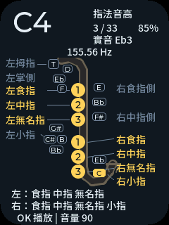
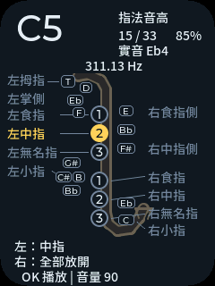
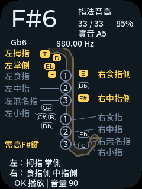

<p align="right">
  <strong>简体中文</strong> · <a href="README.md">English</a>
</p>

# 资源目录（Assets）

本目录集中存放可复用的资源（字库、图片、音乐等），按资源类型分子目录管理。每个资源放在其类型对应的子目录，并记录放置路径、命名方式、集成方式与来源/许可。二进制资源（字体、图片、音频）不属于纯 markdown 文档，请勿与文档混放。涉及版权/授权的资源需注明来源与许可。

## 字库（fonts）

可复用的字库文件与生成的字库源码放在 `fonts/`。

- 命名要能反映字族、字重、字级与格式。
- 记录来源、许可、字符范围、转换命令与目标放置路径。
- 添加字库前评估 Flash 与内部 RAM 影响；ESP32-C3 无 PSRAM。
- 不提交许可不允许分发的字库。

<a id="sax-ui-font"></a>
### 萨克斯界面字体

`fonts/sax_tc_14.c` 定义 `sax_tc_14`：重命名的 SaxTCUI 子集，字重 500，
14 px、未压缩 4 bpp、无字偶距、行高 17 px。
字符表 `fonts/sax_tc_14.txt` 包含可打印 ASCII 及 `main/sax_ui.c`、
`main/sax_diagram.c` 中全部非 ASCII 字符，目前 131 字符。
`main/CMakeLists.txt` 仅编译一次，中文控件和自绘提示明确选择该字体。
这是固定界面子集，不是通用中文字体。

来源：[Noto Sans TC 可变字体](https://github.com/google/fonts/blob/e7db6ca603fd4862010383ff17ffd6cc4ffac1c0/ofl/notosanstc/NotoSansTC%5Bwght%5D.ttf)，
Google Fonts 提交 `e7db6ca603fd4862010383ff17ffd6cc4ffac1c0`。
原字体 SHA-256：`864727d210d54f2537bbe23b3a839436c3992af72de9322af5270897246bd44f`。
Copyright 2014–2021 Adobe；[SIL OFL 1.1](fonts/OFL-NotoSansTC.txt)。
完整 11.9 MB 原字体另行下载，不进入固件；中间子集重命名，避免使用保留字体名称。

使用 Python／fonttools 4.61.1 与 Node／lv_font_conv 1.5.3，从仓库根目录重现：

```sh
python3 tools/generate_sax_font.py --source /path/to/NotoSansTC.ttf --converter /path/to/lv_font_conv
```

脚本核对原字体哈希及字符映射，提取子集并实例化字重 500，再调用
`--size 14 --bpp 4 --format lvgl --no-compress --no-kerning`。
中文文案变更后重新生成，并执行[应用指南](../docs/applications/eb-sax.zh_CN.md#字体与主机预览)的覆盖及渲染检查。
生成的 C 文本约 59 KB，编译后的字形常量位于 Flash，不是 59 KB RAM 分配。
应检查实际 ELF／map 和板上 heap，不能把源码字节数当成固件或运行成本。

## 图片（images）

可复用的源图与生成的显示资产放在 `images/`。

| 文件 | 尺寸与格式 | 用途与来源 |
| --- | --- | --- |
| [`images/home.jpg`](images/home.jpg) | 3840 × 2160，JPEG | 嵌入中英文项目 README 的产品主图，突出 AI Passport 产品形象与开放、人人可创作的理念。 |
| [`images/readme-hardware-specs.png`](images/readme-hardware-specs.png) | 2172 × 724，PNG RGBA | 保留为可选技术参考图，不再用于首页主视觉。于 2026-09-17 使用内置图像生成工具为本仓库生成；已根据文档中的硬件能力契约核对图中的六项标签与参数。 |
| [`images/logo-wordmark.png`](images/logo-wordmark.png) | 1648 × 336，PNG RGBA | 从仓库原始 `images/logo.png` 中精确裁切并去除背景的黑色字标；用于中英文项目 README 的浅色主题。 |
| [`images/logo-wordmark-dark.png`](images/logo-wordmark-dark.png) | 1648 × 336，PNG RGBA | 提取字标的白色版本；README 使用 `<picture>` 在 GitHub 深色主题下显示。 |

- 使用描述性命名，并记录尺寸、像素格式、转换步骤与目标路径。
- 优先采用适合 240 × 320 RGB565 显示的格式，并纳入 Flash 与内部 RAM 考量。
- 许可允许时保留可编辑源文件，并记录来源与许可。
- 图片中不得包含设备二维码秘密、凭证或个人数据。

<a id="sax-ui-previews"></a>
### 萨克斯界面预览

`images/sax-fingering-C4.png`、`images/sax-fingering-C5.png`、
`images/sax-fingering-Fs6.png` 是 240 x 320 RGB PNG 预览，由实际 LVGL UI 的
`tests/sax_ui_host` 生成（命令见应用指南）。用 Pillow 的
`Image.open(ppm).save(png)` 转换 PPM，不缩放。
它们仅用于文档，不作为固件位图，也不是设备实拍。可编辑源为
`main/sax_ui.c`／`main/sax_diagram.c`，原创示意图采用仓库许可，不复制 Yamaha 海报。
字体部分遵循上述 OFL。仍需在实机检查圆角裁切和字体可读性。





## 音乐与音效（music）

可复用的音乐与音效源码放在 `music/`。

- 记录来源、许可、采样率、位深、声道、转换命令与目标路径。
- 与当前 BSP 音频路径匹配时优先采用 16 kHz、16 位单声道 PCM。
- 嵌入音频前评估 Flash 与内部 RAM 成本；长录音应流式或分块。
- 无再分发许可不提交媒体文件。
